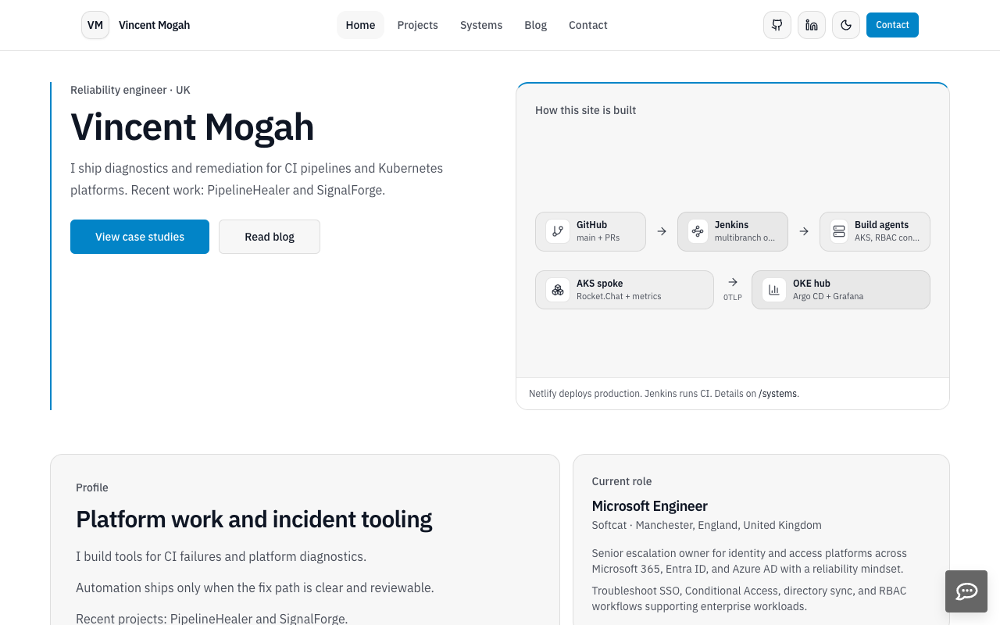

# Portfolio Website

Next.js portfolio for platform reliability work. Live at [portfolio.canepro.me](https://portfolio.canepro.me).

<p align="center">
  
</p>

## What's in the repo

Source for the live site and the infrastructure that builds and runs it.

- `/projects`: case studies (PipelineHealer, SignalForge, Rocket.Chat, GitOps)
- `/systems`: hub-and-spoke map. OKE runs Argo CD and Grafana; AKS runs Jenkins agents and Rocket.Chat
- `/blog`: MDX on CI/CD, Kubernetes, and observability
- `/api/metrics`: custom Prometheus exporter. Grafana Faro handles RUM

PipelineHealer architecture: [github.com/Canepro/pipelinehealer#architecture](https://github.com/Canepro/pipelinehealer#architecture).

## Quick start

Needs Bun 1.3.5+ and Node 22.23.4+ within 22.x or Node 24.22.1+ within 24.x.

```bash
git clone https://github.com/Canepro/portfolio_website-main.git
cd portfolio_website-main
bun install
cp .env.example .env.local   # optional: SMTP, analytics, GitHub token
bun run dev
```

Open [http://localhost:3000](http://localhost:3000).

Preferred local secrets path once Infisical is linked for this checkout:

```bash
infisical login
bun run dev:infisical       # injects canepro-secrets / dev / /portfolio
```

Keep `.env.local` while you validate the Infisical route. A moved checkout can use Infisical instead of copying the env file.

| Command                 | What it does                                      |
| ----------------------- | ------------------------------------------------- |
| `bun run dev`           | Dev server on port 3000                           |
| `bun run dev:infisical` | Same, with Infisical secrets from `/portfolio`    |
| `bun run build`         | Production build                                  |
| `bun run lint`          | ESLint                                            |
| `bun run typecheck`     | TypeScript                                        |
| `bun run format`        | Prettier                                          |

## Stack

Next.js App Router, React 19, TypeScript, Tailwind with CSS variables, MDX blog. Production on Netlify. CI via Jenkins on Kubernetes.

UI primitives: `src/components/ui/*`. Page layout: `src/components/layout/*` (`PageShell`, `SectionCard`, `SectionHeader`).

## Project layout

```
src/app/          pages (home, projects, blog, systems, contact)
src/pages/api/    contact form, Prometheus metrics
src/components/   UI, layout, project cards
src/constants/    projects and certs
src/content/      profile, experience, skills
content/blog/     MDX posts
public/images/    assets
docs/             architecture, deployment, roadmap
```

Visitors can email Vincent directly from the header: [Email Vincent](mailto:vincentmogah@outlook.com). This link needs no configuration.

## Env vars

Copy `.env.example` to `.env.local`. All optional unless you need contact email, analytics, or a higher GitHub API limit.

Infisical wiring for this Mac:

- project: `canepro-secrets` (`.infisical.json`)
- environment: `dev`
- path: `/portfolio`

## Docker

```bash
docker build -t portfolio:test .
docker run --rm -p 3000:3000 portfolio:test
```

## Docs

[Architecture](docs/ARCHITECTURE.md) · [Deployment](docs/DEPLOYMENT.md) · [Contributing](CONTRIBUTING.md) · [Changelog](CHANGELOG.md)

## License

Portfolio use only. All rights reserved.
